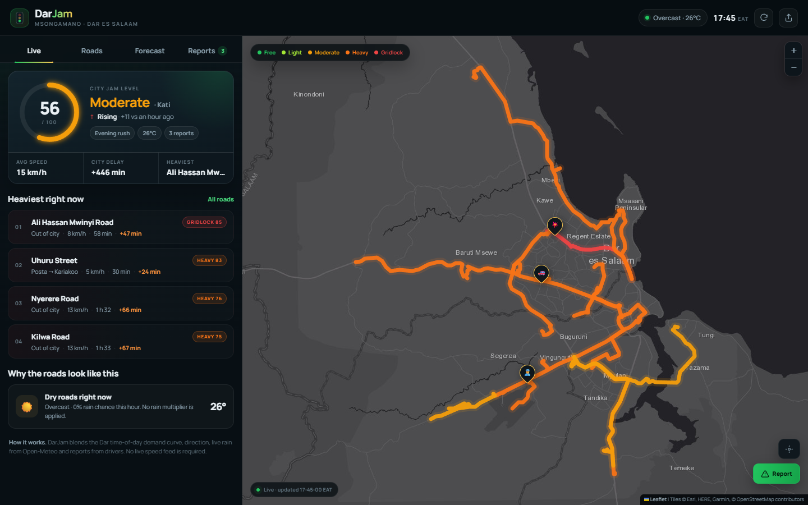
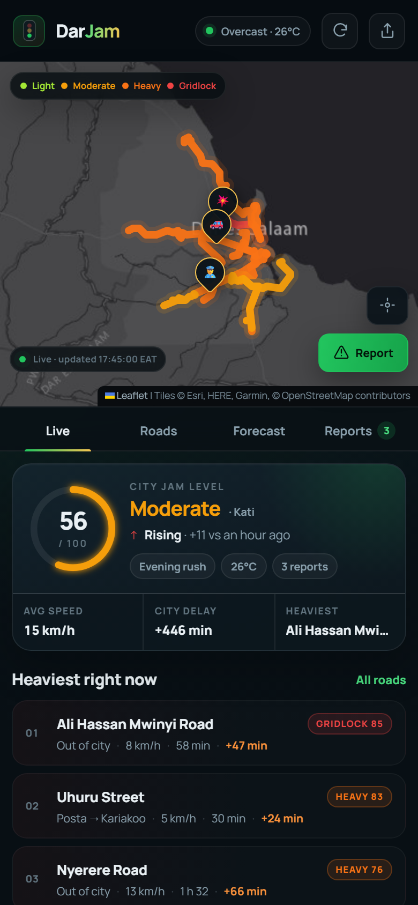

# DarJam

**Msongamano · Dar es Salaam** — a standalone web app and Android app that shows how jammed the roads are right now in Dar es Salaam, road by road, with a 24-hour outlook and community reports.

No paid traffic API and no sign-up. In development it runs without any API keys: the live jams are estimated by a transparent time-of-day traffic model, tuned with live weather and reports from drivers. It runs locally with one command and works on a phone. A commercial release swaps in a licensed tile provider and (optionally) a paid weather plan.

| Desktop | Mobile |
| --- | --- |
|  |  |

## What it does

- **City jam level** — a 0–100 score for Dar es Salaam, mapped to *Free flow / Light / Moderate / Heavy / Gridlock*.
- **Road by road** — 12 corridors (30 segments) including Nyerere Road, Morogoro Road, Ali Hassan Mwinyi, Bagamoyo Road, Kilwa Road, Mandela Road, Sam Nujoma, Kawawa Road, Nyerere Bridge, Uhuru Street, Haile Selassie and Nyerere Road South. Each has both travel directions.
- **Live map** — every corridor drawn in its current colour, with report pins and one-tap "locate me → nearest road".
- **Forecast** — the next 24 hours for the city, plus the quietest windows and a departure planner ("leave now vs. best time").
- **Community reports** — jam, accident, police check, roadworks, flooding or closure, with severity and an optional note. Reports fade out on their own; other drivers can confirm them.
- **Live weather** — rain from Open-Meteo raises demand and lowers speeds; if the API is unreachable the app keeps working on a dry baseline.
- **Deep links** — `#/live`, `#/roads`, `#/forecast`, `#/reports`, `#/road/<corridorId>`.

## Quick start

Requires Node.js 20 or newer (tested on Node 24).

```bash
npm install
npm start
```

Then open <http://localhost:3000>.

Useful scripts:

| Command | What it does |
| --- | --- |
| `npm start` | Start the server (default port `3000`) |
| `npm run dev` | Same, with `node --watch` restarts |
| `npm test` | Model + API tests (`node --test`) |
| `npm run check` | Syntax-check the server and client entry files |
| `npm run build:data` | Regenerate `server/data/corridors.json` from OSM/OSRM |
| `npm run build:web` | Copy Leaflet into `client/vendor` for the bundled app |
| `npm run build:mobile` | Sync the web bundle into `android/` (see [Android](#android-and-google-play)) |

## How the model works

Every segment is evaluated for the current Dar es Salaam clock time (UTC+3), in each direction:

1. **Demand curve.** A weekday curve with a morning peak (~07:45), a midday plateau and a heavier evening peak (~17:55); Friday evenings are slightly heavier. Weekends use their own, flatter curve.
2. **Direction bias.** Mornings load inbound traffic, evenings load outbound traffic; radial corridors react more strongly than cross-town ones.
3. **Weather.** Rain increases demand and reduces free-flow speed; a high chance of rain without rain yet adds a small buffer.
4. **Volume/capacity.** `baseLoad` per segment × demand × direction × weather, plus any nearby reports.
5. **Speed.** A BPR curve (`speed = free / (1 + 1.9 · vc^3)`) turns that load into km/h, then into travel time and delay.
6. **Score.** `score = 100 · (1 − speed/freeFlow)^0.75`, rounded. 0–24 free flow, 25–44 light, 45–64 moderate, 65–84 heavy, 85+ gridlock.

Reports add a proximity-weighted boost that decays over their lifetime (75 min for a jam, up to 8 hours for roadworks), capped so a single report cannot dominate a corridor. Each confirmation adds a small amount.

This is an **estimate**, not probe data: useful for "is it a bad time to drive?", not for turn-by-turn ETAs.

## Data

- **Road geometry** — generated once from OpenStreetMap via the public OSRM demo server and cached in `server/data/corridors.json`. The app never calls OSRM at runtime. Regenerate with `npm run build:data` (needs internet; this uses a shared demo server, so be gentle).
- **Weather** — Open-Meteo, cached for 8 minutes; stale data is reused if a refresh fails.
- **Reports** — kept in memory and persisted to `server/data/reports.json` (atomic writes). Expired reports are pruned on read.

Map tiles are configurable. The development default is Esri's keyless Dark Gray Canvas; a commercial release must set `DARJAM_TILE_URL` to a licensed provider (MapTiler, ArcGIS with a key, Stadia Maps…). `npm start` warns about this when `NODE_ENV=production`.

## API

All responses are JSON and `Cache-Control: no-store`.

| Method | Path | Description |
| --- | --- | --- |
| GET | `/api/health` | Uptime, dataset size, weather status |
| GET | `/api/config` | Branding, levels, report types, model metadata |
| GET | `/api/state` | Everything the client needs on first paint |
| GET | `/api/live` | City score + all corridors (no geometry) |
| GET | `/api/corridors` | All corridors; `?geometry=1` includes polylines |
| GET | `/api/corridors/:id` | One corridor, both directions, plus forecast and "why" |
| GET | `/api/forecast` | `?hours=1..48&corridor=&direction=` |
| GET | `/api/departure` | `?corridor=&direction=&window=1..12` — best time to leave |
| GET | `/api/reports` | `?corridor=&limit=` |
| POST | `/api/reports` | `{ type, severity, corridorId, note?, lat?, lng? }` |
| POST | `/api/reports/:id/confirm` | Confirm a report is still there |

Reports are rate limited to 12 per IP per 10 minutes. A report without `lat`/`lng` is anchored to the middle of its corridor so it still shows on the map.

## Configuration

| Variable | Default | Purpose |
| --- | --- | --- |
| `PORT` | `3000` | HTTP port |
| `HOST` | `0.0.0.0` | Bind address |
| `DARJAM_OFFLINE` | unset | `1` skips the weather fetch and uses a dry baseline (tests use this) |
| `DARJAM_REPORTS_FILE` | `server/data/reports.json` | Where reports are persisted |
| `DARJAM_TILE_URL` | keyless Esri demo tiles | Raster tile template, e.g. `https://api.maptiler.com/maps/dataviz-dark/{z}/{x}/{y}.jpg?key=…` |
| `DARJAM_TILE_LABELS_URL` | Esri reference layer | Optional second tile layer; defaults to `null` when `DARJAM_TILE_URL` is set |
| `DARJAM_TILE_ATTRIBUTION` | Esri/OSM text | Attribution shown on the map |
| `DARJAM_TILE_MAX_ZOOM` | `16` | Native zoom of the tile layer |
| `DARJAM_ALLOWED_ORIGINS` | `capacitor://localhost,https://localhost,http://localhost:5173` | Comma-separated origins allowed to call `/api/*` cross-origin (Android WebView) |
| `DARJAM_WEBSITE` | unset | Optional public URL the app shares from the top-bar share button |
| `DARJAM_NOW` | unset | **Dev only.** ISO time to freeze the model clock (store screenshots/tests); never set in production |
| `DARJAM_WEATHER` | unset | `off` disables weather entirely (no external calls) |
| `OPEN_METEO_API_KEY` | unset | Commercial Open-Meteo key, sent as `apikey` |

The app also reads `client/config.js` at startup: `window.DARJAM_API_BASE` points a
bundled build at the hosted API, and `window.DARJAM_ADS` enables AdMob (the
generated mobile bundle sets both automatically).

```powershell
$env:PORT=3100; npm start
```

## Deploy

The server is one Node process with no database. A `Dockerfile` and a Render
Blueprint (`render.yaml`) are included.

```bash
docker build -t darjam .
docker run -p 3000:3000 -v darjam-data:/app/data darjam
```

Set the tile and weather variables from the table above for a commercial
deployment, and `DARJAM_ALLOWED_ORIGINS` so the Android app may call the API.
Reports are stored in `DARJAM_REPORTS_FILE`; mount `/app/data` as a volume to keep
them across restarts.

## Android and Google Play

The Android app is a Capacitor 8 shell around the same client. The UI is bundled
inside the APK, and calls a hosted HTTPS API whose URL is set at build time. Ads
are served by AdMob inside the native app; the web build stays ad-free.

```bash
# Point the bundle at the hosted API and sync the web assets
npm run build:mobile -- --api-base https://api.example.com --ads

# Build a release bundle (needs JDK 21 + Android SDK)
cd android
./gradlew bundleRelease
```

- App id `tz.darjam.app`; `compileSdk`/`targetSdk` 36.
- Launcher and splash assets live in `android/app/src/main/res`, generated from
  `docs/brand/`.
- Native geolocation, hardware back button, native Share sheet and
  system-safe-area padding, plus a dark system bar treatment.
- `client/ads.js` shows a consent message, an adaptive banner, and an
  interstitial from the fourth launch onwards. Google test IDs are used until
  `DARJAM_ADMOB_BANNER`/`DARJAM_ADMOB_INTERSTITIAL` are set with
  `DARJAM_ADMOB_TEST=0`.
- Signing reads `DARJAM_KEYSTORE`, `DARJAM_KEYSTORE_PASSWORD`, `DARJAM_KEY_ALIAS`
  and `DARJAM_KEY_PASSWORD`; no keystore is committed.
- `.github/workflows/android.yml` builds and uploads a signed AAB from those
  secrets.
- Store copy and graphics: `docs/store/`.
- Full publishing path, forms and payout setup: **[docs/PLAY_LAUNCH.md](docs/PLAY_LAUNCH.md)**.

## Project layout

```
server/
  index.js            Express app, REST API, security headers, CORS
  traffic/engine.js   Pure traffic model: demand, BPR, reports, forecast
  traffic/weather.js  Open-Meteo client with cache and offline fallback
  reports/store.js    In-memory reports + JSON persistence
  data/corridors.json Generated corridor geometry and calibration
client/
  index.html          App shell and report modal
  app.js              Routing, map, charts, report flow, polling
  ads.js              AdMob banner/interstitial (native app only)
  config.js           Runtime API base + ads config for bundled builds
  style.css           Design system and responsive rules
  privacy.html        Privacy policy (Play requirement)
  terms.html          Terms of use
  fonts/              Self-hosted Manrope woff2 files
android/              Capacitor Android project (icons, manifest, signing)
docs/
  PLAY_LAUNCH.md      Play Console, signing, testing and payout checklist
  store/              Listing copy, icon, feature graphic, screenshots
scripts/
  build-corridors.mjs Regenerates corridor data from OSRM
  build-mobile.mjs    Generates config.js, syncs vendor files, runs cap sync
  sync-vendor.mjs     Copies Leaflet into client/vendor for bundled builds
test/
  engine.test.js      Model behaviour and dataset integrity
  api.test.js         HTTP endpoints, validation, reports, CORS
```

The web client is plain ES modules with no build step; Leaflet is served from
`node_modules` under `/vendor/leaflet` (and copied into `client/vendor` for the
Android bundle).

## Limitations

- Jams are modelled from time of day, weather and reports. There is no live speed feed, so unusual incidents take a few minutes and a couple of reports to show up.
- Calibration is based on typical Dar patterns, not a measured survey; treat scores as relative guidance.
- Reports are anonymous and unauthenticated beyond the per-IP rate limit. Don't rely on them for safety-critical decisions.
- Weather and map tiles come from public services without an SLA; the app degrades gracefully but may show a dry baseline or plain background if they are unavailable. Commercial distribution requires a licensed tile provider and a commercial weather plan (or `DARJAM_WEATHER=off`).
- Corridor coverage is a curated set of 12 main roads, not the entire street network.
- The Android app needs a hosted API; it is a thin native shell around the same client, with ads and native permissions, not a fully offline app.
